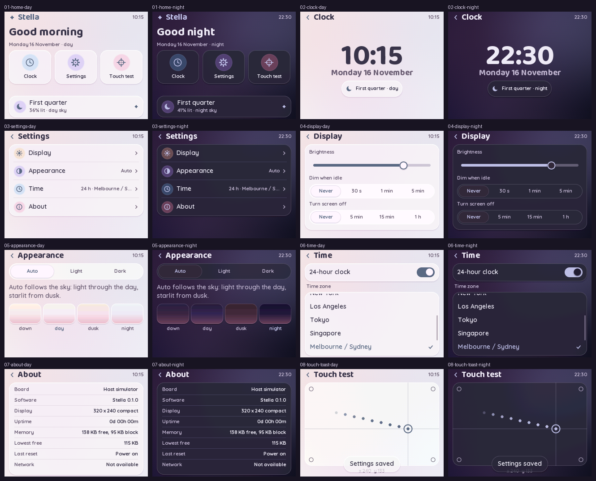

# Stella/32

A lightweight operating environment for ESP32 devices.

Stella gives small touch devices what an app needs, and nothing a PSRAM-less
ESP32 cannot afford: a multi-app runtime, a soft and clean UI toolkit in the
[Celestia Glow](https://github.com/Homura8/celestiaglow) style, a
dirty-rectangle renderer, gesture input, background jobs, supervision, power
management and versioned settings.



*Rendered on the host by the production renderer (`tools/screenshots.py`).*

## Status

| | |
| --- | --- |
| Version | 0.1.0, foundation |
| First board | ESP32-2432S028R "Cheap Yellow Display" (2.8" 320x240, XPT2046) |
| Host tests | 45 tests under ASan + UBSan; screenshots at 320x240 and 480x320 |
| Firmware build | Compiles with Arduino-ESP32 3.3.12: 1.09 MB flash, 65 KB static RAM |
| On hardware | **Not yet verified on a physical CYD.** See the checklist below. |

Built-in apps: **Home** (launcher), **Clock**, **Settings** (display,
appearance, time, about) and **Touch test** (calibration aid).

## Quick start

### Host: tests and screenshots (no hardware)

Requires CMake, a C++17 compiler and Python 3 with Pillow.

```bash
cmake -S . -B build
cmake --build build -j
./build/stella_tests
python3 tools/screenshots.py
```

### Firmware: CYD

Requires [arduino-cli](https://docs.arduino.cc/arduino-cli/) 1.x. The pinned
profile installs Arduino-ESP32 3.3.12, TFT_eSPI 2.5.43 and
XPT2046_Touchscreen 1.4.0.

```bash
arduino-cli compile --profile cyd examples/CYD
```

```bash
arduino-cli upload --profile cyd -p /dev/ttyUSB0 examples/CYD
```

For network time, copy `examples/CYD/secrets.example.h` to
`examples/CYD/secrets.h` (ignored by git) and fill in your Wi-Fi network.
Without it Stella runs offline and shows "--:--" until the time is known.

In the Arduino IDE: add this repository as a library, open
*File > Examples > Stella32 > CYD*, choose *ESP32 Dev Module* with the
*Huge APP* partition scheme.

## Repository guide

| Path | Contents |
| --- | --- |
| `src/stella/` | The OS, layered (see `docs/ARCHITECTURE.md`) |
| `src/stella/apps/` | Built-in apps |
| `src/stella/boards/cyd/`, `src/stella/port/esp32/` | CYD drivers, ESP32 port |
| `examples/CYD/` | Firmware sketch, TFT setup and pinned build profile |
| `host/` | Simulated board and screenshot simulator |
| `tests/` | Unit and integration tests |
| `tools/` | Architecture guard, screenshot and font generators, fonts |
| `docs/` | Architecture, design system, app and porting guides, screenshots |
| `AGENTS.md` | Rules and workflows for coding agents (read before changing code) |

## Documentation

- [Architecture](docs/ARCHITECTURE.md): layers, threads, rendering, memory.
- [Design system](docs/DESIGN.md): Celestia Glow tokens, materials, components.
- [Writing an app](docs/APPS.md)
- [Adding a board or display](docs/PORTING.md)

## Hardware checklist (first CYD flash)

1. Boot log shows `Stella 0.1.0 on ESP32-2432S028R (CYD), 320x240 compact`;
   the home screen appears without flicker or colour inversion.
2. *Touch test*: taps land on the four corner targets.
3. Every built-in screen matches `docs/screenshots/320x240/`.
4. Brightness slider, dim and screen-off timeouts work; the touch that wakes a
   dark screen does not activate anything, while a tap on a dimmed screen
   brightens it and acts. Single quick taps open apps reliably.
5. Settings survive a reset (written about 1.5 s after the last change).
6. With `secrets.h`: the Wi-Fi icon turns from pink to muted, and the clock
   shows local time within a minute.
7. Leave it running overnight; no `[runtime] ... restarting` in the log.

## Licence

No licence has been chosen yet; all rights are reserved by the repository owner
until one is added. Bundled fonts are under the SIL Open Font License 1.1; see
[THIRD_PARTY_NOTICES.md](THIRD_PARTY_NOTICES.md).
