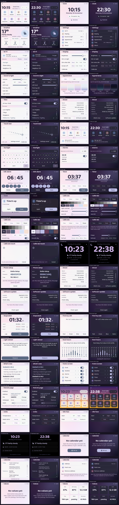

# Design system: Celestia Glow for small screens

Stella's interface inherits the visual language of
[Celestia Glow](https://github.com/Homura8/celestiaglow): a *frosted
observatory*: soft pastel skies, translucent glass surfaces, quiet text colours
and playful rounded forms. Everything here is implemented in
`src/stella/ui/theme.cpp` (tokens) and `src/stella/ui/materials.cpp` (surfaces);
change those, not individual screens.

## Principles

- **Calm.** One accent at a time, muted secondary text, generous spacing.
  Every element earns its space.
- **Soft.** Rounded cards and pill controls; anti-aliased edges everywhere.
- **Atmospheric.** The sky changes with the time of day; nights are starlit
  and dim for a bedside device.
- **Legible first.** Decorative effects never reduce text contrast; touch
  targets stay at least 32 dp tall.

## Sky (background)

`paintSky()` draws the site's 120° three-stop gradient (`--bg-1..3`) with soft
pink (top-left), sky-tint (top-right) and gold (bottom) washes, using ordered
dithering so RGB565 never bands.

| Phase | By the clock (fallback) | Light accent | Dark accent |
| --- | --- | --- | --- |
| Dawn | 05–08 | `#85586b` | `#e1bccb` |
| Day | 08–17 | `#5d6980` | `#c1cbe0` |
| Dusk | 17–20 | `#775386` | `#d6b7e5` |
| Night | 20–05 | `#625e84` | `#bdbde7` |

The phase follows the **real sun** whenever the Weather place has told the shell
about today (`AppContext::setSun`, from `core/solar`): dawn runs from 45 minutes
before sunrise to 75 minutes after it, day until an hour before sunset, dusk until
45 minutes after sunset, then night; in polar summer it is day all day, in polar
winter night. The hours in the table are the fallback (no time, no Weather app).
Night dimming and the bedside face's auto-start use the same phase.

Appearance `Auto` is light at dawn/day and dark ("starlit") at dusk/night;
`Light` and `Dark` pin the mode while the sky still follows the phase.
Tapping a sky swatch in *Settings > Appearance* keeps that sky (tap it again
to follow the time); night dimming still follows the clock.

## Panel calibration (`Look`)

Small TN panels (like the CYD's) wash pastels out to white, lift dark tones
(text looks light lilac, "dark" mode looks grey), run cold and flatten the
sky phases. *Settings > Display > Calibrate* tunes how the palette is
rendered on this panel, live, against the same screen on a good monitor
(`docs/screenshots/*/17-calibrate-tone-*.png`). Three tabs, each with a
*Reset* to the board's defaults:

- **Tone**
  - **Contrast** (0-100 %, separate for light and dark mode): a gamma
    (1.0 at 0 %, 2.2 at 100 %) on backgrounds and materials, and in light mode
    on text too. In dark mode light inks (text, accent, lines, toggles) keep
    their level, so controls stay visible on the deepened background.
  - **White level** (0-100 %): compresses the tones above a knee (200 of
    255), so pure white does not glare next to near-whites after a strong
    contrast.
  - **Warmth** (0-100 %): trims blue (up to 16 %) and a little green (5 %).
- **Colour**: the palette tone (below) and **Smooth sky** (ordered dithering
  of the sky gradient; off = plain rounding).
- **Panel** (displays with `Display::PanelTrim`): the LCD's VCOM offset and
  frame rate. They start at the panel driver's values; change them only if
  the screen shimmers.

All of it is applied once in `makeTheme` (and `Display::setPanelTrim`), so
drawing code never changes. The design defaults (Soft, 0 %, white 100 %,
warmth 0 %) are what the screenshots show; a board sketch sets its panel's
defaults. The CYD starts at Rich, contrast 86 % light / 74 % dark (matched to
a Mac by eye on a CYD), white 70 %, warmth 30 %. Tones:

| Tone | Light skies | Saturation | Light depth (gamma) | Edges and shadows |
| --- | --- | --- | --- | --- |
| Soft | as designed | 1.0x | 1.0 | 1.0x |
| Rich | 30% toward the phase tint | 1.45x | 1.35 | 1.7x |
| Vivid | 48% toward the phase tint | 1.9x | 1.7 | 2.4x |

Tones never change text colours (contrast does); accents get half the
saturation gain; dark skies only gain saturation.

## Materials

| Token | Light | Dark | Use |
| --- | --- | --- | --- |
| `text` | `#3d354d` | `#eee8f5` | primary text |
| `textMuted` | `#685e74` | `#bcb2c9` | captions, values, chevrons |
| `glass` | `#fffdff` @ 70% | `#2e283f` @ 83% | cards, pills |
| `rim` | white @ 94% | `#eddeff` @ 18% | 1 px highlight edge on glass |
| `line` | `#5d4878` @ 13% | `#d7c5ef` @ 16% | hairlines, tracks |
| `shadow` | `#4b346c` @ 12% | `#080414` @ 27% | soft two-layer drop shadow |
| `surface` | `#faf7fb` | `#302a3d` | opaque chips, toggle/slider knobs |
| `tints[0..3]` | pink, lavender, sky, peach | deep versions | icon bubbles |

`paintGlass()` = shadow + translucent fill + rim. Raised surfaces cast shadow
`glassOutset()` pixels outside their rectangle; invalidate that margin too.

## Typography

| Role | Font | Compact | Regular | Use |
| --- | --- | --- | --- | --- |
| `caption` | Quicksand 700 | 11 px | 13 px | labels, values, status bar |
| `body` | Quicksand 600 | 14 px | 17 px | default text, list rows |
| `title` | Baloo 2 700 | 19 px | 24 px | screen titles, emphasis |
| `headline` | Baloo 2 700 | 26 px | 34 px | greetings, big values |
| `display` | Baloo 2 700 | 64 px | 88 px | clock digits only |
| `bedside` | Baloo 2 700 | 96 px | 144 px | the bedside clock's digits only |

Fonts are rasterised with 4-bit anti-aliasing by `tools/fontgen.py` from the
site's own WOFF files.

## Metrics

All lengths come from `Theme::m` (and `t.dp(n)` for rare custom lengths, where
16 = 1.0x on compact panels).

| Token | Compact | Regular |
| --- | --- | --- |
| `margin` (screen edge) | 10 | 14 |
| `gapS / gapM / gapL` | 4 / 8 / 12 | 6 / 11 / 17 |
| `padding` (inside cards) | 10 | 14 |
| `radiusCard / radiusControl` | 16 / 12 | 22 / 16 |
| `statusBar` | 32 | 44 |
| `control` (buttons, segmented) | 36 | 50 |
| `row` (list rows) | 40 | 56 |
| `icon` | 24 | 32 |

## Components

- **Status bar:** sparkle + "Stella" at home; back chevron + screen title
  elsewhere (tap anywhere in the left third, 32 dp tall, to go back;
  long-press anywhere on it for home). Network icon and time at the right, in `textMuted`.
- **Glass card:** groups related rows; rows separated by hairlines.
- **List row:** icon bubble, title, optional muted value, chevron.
- **Scrolling list:** drag to scroll, and when it overflows a strip at the
  right edge (32 dp wide) holds an up and a down button (each pages by a view
  less one row; dimmed at the ends) with a thin position rail between them.
  Rows are drawn and picked beside the strip; a list that fits has none.
- **Segmented choice:** glass pill; the selected chip is an opaque `surface`
  chip with a hairline and accent text (the site's sky chooser).
- **Toggle:** pill track (accent when on) with a soft knob.
- **Slider:** thin track, accent fill, `surface` knob with an accent ring.
- **Toast:** glass pill above the bottom edge, 2.2 s.
- **Keyboard:** four rows sized from its bounds; letter keys are glass,
  function keys `surface` chips, the action key is an accent pill (greyed
  until the input is valid). One-shot shift, two symbol pages; long-press
  delete clears.
- **Text field:** glass pill, accent caret; secrets show bullets with a
  *Show/Hide* toggle.
- **Phone setup:** one glass card of three labelled rows (Wi-Fi name in
  `title`, the temporary password in `headline` and the accent, the page
  address in `title`), a centred status line in `body` (the error in
  `danger`), and a Cancel button.
- **Wi-Fi:** signal shown as 0-4 arcs (`icons::wifiBars`); the status bar
  icon is muted when connected, accent while joining, soft pink on failure.
- **Alert:** a soft veil over the whole screen and a near-opaque glass card:
  icon bubble (in the app's tint) with a `headline` title, a muted message of
  up to two lines, then a glass secondary and an accent primary button.
- **Alarms:** "Next alarm in ..." caption; a glass list of alarms (time in
  `title`, days in `caption`, a switch). The editor has display-font hour and
  minute digits (tap the top/bottom half or drag to change), an AM/PM pill in
  12-hour mode, Monday-first day chips (accent when on) and Delete/Save.
- **Timer:** display-font countdown over a thin accent progress track, a
  muted "Ends at ..." line, preset chips and Reset / +1 min / Start.
- **Home:** greeting, date, a grid of square app tiles. When the apps span
  several pages, a glass pill of ‹ › buttons sits beside the greeting
  (swiping also works; resistive panels make swipes hard).
- **Bedside clock:** fullscreen on black (`bedBg`); a sleepy crescent moon
  (top left), four-point sparkles (top right), ten faint stars at the edges
  and a ringed planet, all in `bedStar`/`bedMuted`; the date on top in
  `bedMuted`; the clock in the `bedside` font in `bedClock` (lilac), with a
  thin rule and a small star under it; the weather ("[icon] 17° Partly
  cloudy", `title`, `bedText`) and "[bell] 06:45 · in 8 h 15 min" (`body`,
  `bedMuted`); "Tap anywhere to return" in `bedStar` at the bottom. No
  chrome, no sky gradient. If "88:88" plus AM/PM does not fit the width (a
  portrait panel) the smaller `display` numerals are used.
  *Settings > Display > Bedside* (Off / Night / Always) chooses when it starts
  by itself; the Clock's *Bedside* button starts it by hand.
- **Dashboard idle face:** the same black and dim ink as the bedside clock (no
  sky, no stars, no motion): the time in the `hometime` font in `bedClock`, the
  date in `bedMuted`, then up to three rounded lines on a faint `bedStar` wash
  (the weather in `title`, the next alarm and the next sunrise or sunset in
  `body`, each with its small icon), and "Tap anywhere to return" in `bedStar`.
  The bedside clock gains the same sun line in `caption` under the alarm.
- **Calendar:** one glass card with a scrolling list (the usual up/down strip). Each
  event is a row: the day label in `caption` and the accent on the first event of a
  day ("Today", "Tomorrow", "Thu 19 Nov"), the title in `body`, and "09:30-10:30 ·
  Room 3.12" in `caption` and `textMuted`; events that are over dim to `textMuted`.
  A freshness line under the card. With nothing to list: a `headline`, a short
  `body` hint and, without an address, a *Set up* button that opens Settings.
- **Weather:** large display-font temperature, condition in `title`, three
  (compact) or four (regular) glass forecast cards, a muted freshness line.

## Reviewing visual changes

`python3 tools/screenshots.py` renders every screen with the production
renderer at 320x240 (compact) and 480x320 (regular), at night (dark) and in
the morning (light), into `docs/screenshots/`. Look at the PNGs before and
after every UI change, and commit them with it. CI fails if the rendered UI
differs from the committed screenshots.
